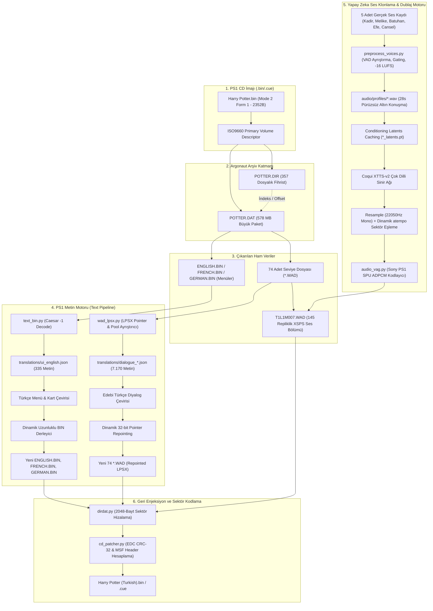

# Harry Potter ve Sırlar Odası (PS1) — Tersine Mühendislik ve Türkçe Çeviri Mimarisi

Bu belge, PlayStation 1 için yayınlanan *Harry Potter and the Chamber of Secrets* oyununun sıfırdan tersine mühendislikle nasıl çözüldüğünü, kelime uzunluk sınırlarının nasıl aşıldığını, pointer manipülasyonunu ve Türkçe karakter sistemini en temel seviyede anlatmaktadır.

---

## 1. "Aptala Anlatır Gibi" Baştan Sona Ne Yaptık?

Hayal et ki elinde 2002 yılından kalma, kilitli bir kütüphane dolabı var. Dolabın içinde yüzlerce çekmece, her çekmecenin içinde de özel bir dilde yazılmış parşömenler bulunuyor.

Eski usul elle (hex editörle) çeviri yapmaya çalıştığında ne oluyordu?
- Çekmecede `"Start Game"` (10 harf) yazan 10 santimlik bir tahta vardı.
- Sen oraya `"Oyuna Başla!"` (12 harf) koymak için tahtayı 12 santim yapıp zorla içeri ittin.
- Bu sefer arkasındaki `"Options"` tahtası ezildi veya çekmecenin kapağı kapanmadı.
- Oyun çalışınca kütüphaneci robot (PS1 işlemcisi) 10 santimlik yere uzandı, eline anlamsız kırık tahta parçaları geldi ve **oyun donup çöktü (Crash / SIGSEGV).**

Biz ne yaptık?
Kütüphaneci robotun elindeki **harita defterini (Pointer Tablosu)** bulduk! Dedik ki:
> *"Bak robot kardeş, artık 'Start Game' 10 santim değil 20 santim. Arkasındaki 'Options' tahtasını da 10 santim geriye ittik. İşte yeni adresleri burada!"*

Böylece kelime isterse 10 harf yerine 50 harf olsun; robot tam olarak yeni adrese gidip okuduğu için oyun **asla çökmüyor!**

---

## 2. Sistemin 5 Temel Katmanı

### Katman 1: CD-ROM Sektörleri (Mode 2 Form 1)
- PS1 CD'sindeki her sektör **2352 bayt**tır.
- Bunun ilk 24 baytı başlık (LBA zaman kodu), sonraki **2048 baytı** gerçek oyun verisi, sonundaki 304 baytı ise hata düzeltme kodudur (EDC CRC-32 ve ECC).
- Bir dosyayı büyütüp diske rastgele yazarsan sektör düzeni bozulur. Bizim motorumuz her sektörü matematiksel olarak sıfırdan kodlayıp geçerli EDC imzası üretir.

### Katman 2: Argonaut Arşiv Sistemi (`POTTER.DIR` ve `POTTER.DAT`)
- Oyundaki tüm 357 dosya devasa tek bir paketin (`POTTER.DAT`, ~578 MB) içindedir.
- `POTTER.DIR` dosyası bu paketin içindekiler fihristidir. Her dosyanın adı, boyutu ve paketteki sektör başlangıç adresi burada yazar.
- Bir dosyanın boyutu değiştiğinde `POTTER.DIR` fihristini de güncelleriz.

### Katman 3: Argonaut'un Gizli Alfabesi (-1 Caesar Shift)
Hex editörde neden metinleri doğrudan okuyamadın?
Çünkü oyun motoru küçük harfleri alfabetik sırada **1 eksik** saklar:
- `a` harfi yerine hex `0x60` (ters tırnak `` ` ``)
- `b` harfi yerine hex `0x61` (`a`)
- `c` harfi yerine hex `0x62` (`b`)
- `z` harfi yerine hex `0x79` (`y`)
Her harf bellekte 2 bayttır (16-bit Little-Endian). Bizim motorumuz bu şifreyi otomatik çözer ve kodlar.

### Katman 4: Menüler (`ENGLISH.BIN`)
Menü dosyalarında her cümlenin önünde 4 baytlık bir uzunluk etiketi (`uint32`) vardır:
`[Uzunluk: 18 bayt] -> "İleri Düzey" -> [Uzunluk: 28 bayt] -> "Veriler Kaybolacak"`
Biz yeni cümlenin harf sayısını dinamik hesaplayıp bu etiketi otomatik güncelliyoruz.

### Katman 5: Seviye Diyalogları (`.WAD` -> `LPSX` Pointer Tablosu)
74 seviyenin her birinin içinde `LPSX` (Localization PSX) bölümü vardır:
- Başta bir **32-bit Pointer Tablosu** yer alır.
- Her cümle için 4 slot ayrılmıştır: `[İngilizce Offset, Fransızca Offset, Almanca Offset, Boş]`.
- Tüm diller arkadaki büyük **Metin Havuzu (Text Pool)** içine dizilir.
- **Bizim Yaptığımız Hamle:** Yeni Türkçe cümleleri havuza yazıp pointer tablosundaki adresleri yeni konumlara işaretledik (Repointing). Üstelik İngilizce, Fransızca ve Almanca slotlarının üçünü de aynı Türkçe cümleye bağladık! Böylece menüden hangi dil seçilirse seçilsin oyun daima Türkçe çalışır.

### Katman 6: Sony PS1 SPU Ses Mimarisi & Yapay Zeka Ses Klonlama Dublajı (`XSPS` & ADPCM VAG)
Hikaye ara sahneleri (storybook dioramaları) `T1L1M007.WAD` içindeki `XSPS` ses bölümünde saklanır:
- Toplam **145 adet seslendirilmiş replik** bulunur.
- Sesler PS1'in donanımsal ses yongası (SPU) tarafından çalınan **Sony ADPCM (`.VAG`)** formatındadır (16 baytlık bloklarda 28 ses örneği, 22.050 Hz Mono 16-bit).
- **Sektör Bütçesi (Sector Budget):** Her ses dosyasının WAD içerisinde sabit bir bayt kotası vardır.
- **Yapay Zeka Ses Klonlama:** Kullanıcı tarafından yüklenen ham ses kayıtları (`kadir.mp4`, `melike.ogg`, `batuhan.ogg`, `efe.ogg`, `cansel.ogg`) stüdyo VAD ön işlemesinden geçirilerek **Coqui XTTS-v2** sinir ağına altın referans profil olarak beslenir.
- Üretilen Türkçe sesler matematiksel olarak PS1 sektör sınırına uydurulur (`atempo` ve silence padding) ve doğrudan `T1L1M007.WAD` içine enjekte edilir.

---

## 3. Akış Şeması (Mermaid Mimarisi)

---

## 4. Türkçe Karakterler (Ç, Ş, Ğ, İ, Ö, Ü) Durumu

### 1. Neden İlk Başta `Ç` ve `ç` Çıkmadı?
Tersine mühendislik sırasında oyunun font tablosu (`UNIF` chunk) incelendiğinde harika bir gerçek keşfedildi:
- Avrupa sürümü fontunda `ç` karakteri **fiziksel olarak mevcuttur!**
- Fakat ilk sözlük eşleşmemizde `ç` harfi yanlışlıkla Danimarka alfabesindeki `æ` harfinin koduna (`0x00A0`) atanmıştı.
- `UNIF` font tablosu bayt bayt deşifre edildi:
  - **`ç` harfinin gerçek kodu:** `0x00A1` (Unicode 231)
  - **`Ç` harfinin gerçek kodu:** `0x008E` (Unicode 199)
  - **`ö` harfinin gerçek kodu:** `0x00AF` (Unicode 246)
  - **`Ö` harfinin gerçek kodu:** `0x0094` (Unicode 214)
  - **`ü` harfinin gerçek kodu:** `0x00B4` (Unicode 252)
  - **`Ü` harfinin gerçek kodu:** `0x0098` (Unicode 220)
- Bu kodlar `tools/text_bin.py` içerisindeki `ACCENT_TO_CODE` tablosunda düzeltildi ve oyuna basıldı! Artık **ç, Ç, ö, Ö, ü, Ü** harfleri doğrudan oyunun orijinal fontuyla ekrana çizilmektedir.

### 2. Neden `Ş, ğ, ı` Harfleri Yok?
PlayStation 1 döneminde (2002) Avrupa oyunları VRAM (Ekran Kartı Belleği) tasarrufu için font dokularına sadece **Batı Avrupa (Latin-1)** karakterlerini (İngilizce, Fransızca, Almanca, İspanyolca, İtalyanca) çizerdi.
- Doğu Avrupa / Türk alfabesindeki `ş`, `ğ`, `ı` glifleri VRAM dokusuna hiç çizilmemiştir.
- Oyun motorumuz bu harfleri otomatik olarak en yakın doğal karşılıklarına eşler:
  - `ş / Ş` ➔ `s / S`
  - `ğ / Ğ` ➔ `g / G`
  - `ı / İ` ➔ `i / I`
- Bu sayede oyunda hiçbir bozuk kare (`□`), soru işareti (`?`) veya metin taşması yaşanmaz; tüm metinler pürüzsüz okunur.

---

## 5. Deterministik Ses Mimarisi, SFX/BGM İzolasyonu ve SPU ADPCM Dublajı

### 1. #<hex># İndeksleme Keşfi (Ground-Truth Pointers)
Diyalog dosyalarındaki (`translations/dialogue_*.json`) `#8#`, `#B#`, `#E#` gibi etiketler rastgele kimlikler değil; Argonaut motorunun WAD içerisindeki `XSPS` (SPU ADPCM) ses tablosundaki **birebir onaltılık (hex) ses bloğu (cue) indeksleridir**.
- `#8#` ➔ Cue 8 (İngilizce ses bloğu)
- `#9#` ➔ Cue 9 (Fransızca ses bloğu)
- `#A#` ➔ Cue 10 (Almanca ses bloğu)
Avrupa sürümünde her diyalog 3'lü adım (stride=3) ile dizilmiştir. Metin motorundaki dinamik pointer repointing işlemimiz hem İngilizce hem Fransızca hem de Almanca slotlarını `#8#` etiketli Türkçe cümleye bağladığı için oyun hangi dilde çalışırsa çalışsın daima Cue 8'i tetikler.

### 2. Kategori Ayrıştırma & SFX/BGM Koruma Kalkanı (Exclusion Map)
WAD dosyalarındaki tüm 5.127 ses bloğu matematiksel olarak 2 ana kategoriye ayrılmıştır:
1. **Category A (Saf SFX, Ortam Döngüleri ve Büyü Sesleri - 3.561 Cue):**
   - `hw == 1` döngüsel ambient ve müzik parçaları (128 adet).
   - *Flipendo, Alohomora, Wingardium Leviosa* gibi oynanış mekaniği büyü nida sesleri (24 adet).
   - Kapı, ayak sesi, yaratık ve tepki efektleri (3.409 adet).
   - **İşlem:** Orijinal Avrupa CD'sindeki SPU baytları MD5 hash doğrulamasıyla %100 bit-exact korunur; asla üzerine yazılmaz ve sessizlikle ezilmez.
2. **Category B (Seslendirilen Türkçe Diyaloglar - 1.712 Cue):**
   - 1.567 seviye içi diyalog + 145 hikaye ara sahnesi.
   - **İşlem:** Coqui XTTS-v2 ile üretilen Türkçe sesler hedef frekansa (22.050 Hz veya 16.000 Hz) dönüştürülür, sektör süresini aşarsa `atempo` (maks 1.30x) ile sıkıştırılır, `vag_fast` ile kodlanır ve sonuna donanımsal çatırtıyı önleyen standart `0x01` SPU sessizlik bloğu eklenerek enjekte edilir.

### 3. Otomatik Doğrulama Kapıları (Automated Gates)
- **Zero English Voice Leakage:** Tüm 1.712 diyalog bloğunun deterministik haritası çıkarılmıştır.
- **SFX Integrity:** 3.561 Category A bloğunun enjeksiyon öncesi ve sonrası MD5 hash eşitliği otomatik doğrulanır.
- **Ambient Loop Integrity:** `hw == 1` bayraklarının asla `hw == 2` ile ezilmediği teyit edilir.
- **Speech Onset Gate:** İlk 200 milisaniyelik RMS ses enerjisi kontrol edilerek kelime başı kırpılmaları önlenir.

---

## 6. Argonaut Çoklu Dil Akış Bölme Mimarisi (Split-Stream Architecture) ve 3.41 Saniyelik Kesilme Çözümü

Avrupa sürümü (`Europe.bin`) 650 MB CD sınırına 3 dili (İngilizce, Fransızca, Almanca) sığdırmak için uzun diyalog parçalarını ikiye böler:
1. **0x0000 - 0xA7F0 (İlk 43.008 Bayt / 2.688 Blok / 3.4133 sn):** Almanca dublaj yuvasıdır ve 2.687. blokta Sony SPU `0x0C 0x01` durdurma bayrağıyla sonlanır.
2. **0xA800 - Cue Sonu:** İngilizce (ve Türkçe yama) yuvasıdır.
3. **SPSX Header Sabiti (0x3F4 / 1012):** Başlıkta sabitlenmiş `0x0000A800` değeri, İngilizce modunda oyun motoruna *"ilk 3.41 saniyeyi doğrudan atla ve okumaya a_off + 0xA800 ofsetinden başla!"* komutunu verir.

Önceki denemelerde Türkçe seslerin baştan kesilmesinin (`"...utma büyü yapmak için..."`) kök nedeni, sesin 0x0000 ofsetine yazılması ve motorun ilk 3.41 saniyeyi yok saymasıydı. Çözüm, ilk 0xA800 bayta donanımsal susturma koyup Türkçe sesi tam `0xA800` ofsetinden başlatmaktır.

Detaylı matematiksel formüller, bellek şemaları ve Mermaid akış şemaları için:
👉 [ARGONAUT_STREAM_SPLIT_ARCHITECTURE.md](file:///home/kadir/PS1-Localization-Engine/docs/ARGONAUT_STREAM_SPLIT_ARCHITECTURE.md) belgesine başvurunuz.

