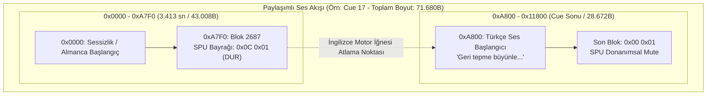
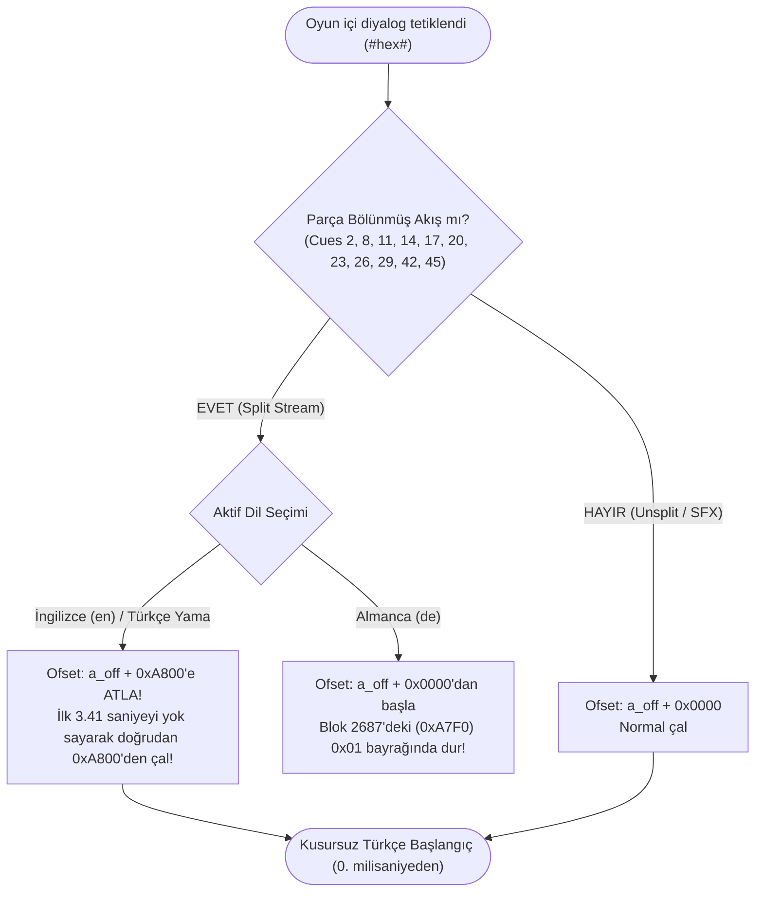
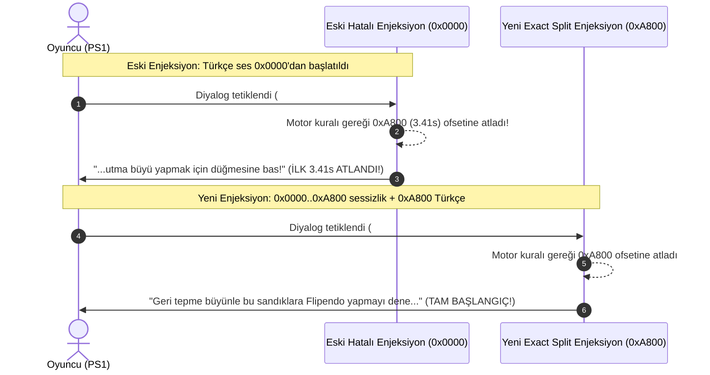

# Argonaut Games Çoklu Dil Akış Bölme Mimarisi (Split-Stream Architecture)
## PS1 SPU ADPCM Akış Formatı, 0xA800 Ofset Sabiti ve 3.4133 Saniyelik Kesilme Çözümü

> **Kritik Sistem Belgesi:** Bu belge, PlayStation 1 *Harry Potter and the Chamber of Secrets* (Argonaut Games, 2002) Avrupa sürümündeki (`Europe.bin`) çoklu dil ses akış mimarisini, SPSX başlığındaki gizli ofset sabitlerini ve Türkçe dublaj yerelleştirmesinde uzun diyalogların baştan kesilmesini önleyen kesin matematiksel şemayı açıklar.

---

## 1. Mimarinin Doğuşu: 650 MB CD-ROM'a 3 Dili Sığdırma Zorunluluğu

2002 yılında Argonaut Games mühendisleri, Avrupa bölgesi için İngilizce, Fransızca ve Almanca olmak üzere 3 tam seslendirmeyi tek bir 650 MB CD-ROM diske sığdırmak zorundaydı.

Her seviyenin ses arşivi (`.WAD` dosyası içerisindeki `XSPS` bölümü), PS1 SPU (Sound Processing Unit) için 4-bit Sony ADPCM (VAG) formatında sesler içerir. Argonaut, CD alanından tasarruf etmek için şu stratejiyi geliştirmiştir:

1. **Fransızca Replikler:** Ayrı, daha düşük örnekleme hızına (16.000 Hz) sahip müstakil slotlarda (`hw=2, 0x05CE`) saklanır.
2. **Kısa Replikler ve Efor Sesleri:** Bağımsız tekil slotlarda (`a_off + 0x0000`) başlar.
3. **Uzun Diyaloglar (Multi-Language Shared Streams):** Almanca ve İngilizce seslendirmeleri **aynı ses akışı içerisinde birleştirilmiştir (Shared Stream)**!

---

## 2. 0xA800 Ofset Sabiti ve Matematiksel Şema

SPSX başlığının 1012. baytında (`0x3F4` ofsetinde) 32-bit bir donanım sabiti tanımlanmıştır:
$$\text{Split Offset} = \text{0x0000A800} = 43.008 \text{ Bayt}$$

### PS1 SPU Donanım Hesaplamaları

* Sony ADPCM Blok Boyutu: **16 bayt** (1 bayt shift/filter, 1 bayt loop/end flag, 14 bayt ses verisi = 28 örnek).
* Blok Başına Örnek: **28 sample**.
* Örnekleme Hızı: **22.050 Hz**.

$$\text{Blok Sayısı} = \frac{43.008 \text{ bayt}}{16 \text{ bayt/blok}} = 2.688 \text{ blok}$$

$$\text{Örnek Sayısı} = 2.688 \text{ blok} \times 28 \text{ örnek/blok} = 75.264 \text{ örnek}$$

$$\text{Zamanlama Eşiği} = \frac{75.264 \text{ örnek}}{22.050 \text{ Hz}} = \mathbf{3{,}41333\dots \text{ Saniye}}$$

```
+-------------------------------------------------------------------------------+
|                       ARGONAUT SHARED STREAM CUE (a_off)                      |
+---------------------------------------+---------------------------------------+
|   Bölüm 1: 0x0000 .. 0xA7F0           |   Bölüm 2: 0xA800 .. Cue Sonu         |
|   (2.688 Blok = 43.008 Bayt = 3.41s)  |   (Değişken Boyut)                    |
+---------------------------------------+---------------------------------------+
|  ALMANCA DUBLAJ VEYA SESSİZLİK       |  İNGİLİZCE / TÜRKÇE DUBLAJ            |
|                                       |                                       |
|  * 0. örnekten başlar                 |  * 0. örnekten başlar                 |
|  * Blok 2687 (0xA7F0):                |  * Oyun dili İngilizce ise motor     |
|    0x0C 0x01 (Terminal Loop/End Flag) |    doğrudan 0xA800'den okumaya başlar!|
|  * Almanca modunda burada ses kesilir |  * Son blok: 0x00 0x01 SPU End Flag   |
+---------------------------------------+---------------------------------------+
```

---

## 3. Mermaid Mimari Diyagramları

### A. Ses Akışı Bellek Haritası (ADPCM Memory Map)



### B. Argonaut Ses Motoru Oynatma Karar Akışı



### C. Eski Yanlış Enjeksiyon vs. Yeni Exact Split Enjeksiyon Karşılaştırması



---

## 4. Kovuk Bahçesi (T1L2M001.WAD) Tam Cue Sınıflandırma Tablosu

### A. 11 Adet Bölünmüş Akış (Split Cues — `a_off + 0xA800`)

Bu diyaloglar kesinlikle `a_off + 0xA800` ofsetine yazılmalı, ilk `0xA800` baytına sessizlik yerleştirilmelidir:

| Cue | Karakter | WAD Ses Ofseti (`a_off`) | Türkçe Yazım Noktası | Maks. Boyut | Ayrılmış Süre | Açıklama |
|:---|:---|:---|:---|:---|:---|:---|
| **02** | `ron` | `0x04F000` | `0x059800` | 51.200 B | 4.06 s | "Merhaba Harry! Evime hoş geldin..." |
| **08** | `ron` | `0x07E800` | `0x089000` | 59.392 B | 4.71 s | "Hadi Harry, tavan arası kapısı kilitliyse..." |
| **11** | `ron` | `0x0A6000` | `0x0B0800` | 88.064 B | 6.99 s | "Babam bahçeye birkaç sandık koymuş..." |
| **14** | `ron` | `0x0D9800` | `0x0E4000` | 114.688 B | 9.10 s | "Hortlak boruları devirip duruyor..." |
| **17** | `ron` | `0x119000` | `0x123800` | 71.680 B | 5.69 s | "Geri tepme büyünle bu sandıklara..." |
| **20** | `mrs_weasley`| `0x140000` | `0x14A800` | 137.216 B | 10.89 s | "Ronald Weasley! Sana o hortlağın..." |
| **23** | `ron` | `0x187800` | `0x192000` | 94.208 B | 7.48 s | "Hadi Harry, hortlağı sakinleştirelim..." |
| **26** | `ron` | `0x1BC000` | `0x1C6800` | 75.776 B | 6.01 s | "Tavan arasına çıkmamız gerek..." |
| **29** | `ron` | `0x1ED800` | `0x1F8000` | 102.400 B | 8.13 s | "İşte burada, dikkatli ol..." |
| **42** | `ron` | `0x324800` | `0x32F000` | 114.688 B | 9.10 s | "Bahçedeki cücelerden kurtulmamız gerek..."|
| **45** | `ron` | `0x36A000` | `0x374800` | 45.056 B | 3.58 s | "Bir cüce yakala ve onu savur..." |

### B. 6 Adet Bölünmemiş Akış (Unsplit Cues — `a_off + 0x0000`)

Bu diyaloglar standart tekil parçalardır ve doğrudan `a_off + 0x0000` ofsetinden başlar:

| Cue | Karakter | WAD Ses Ofseti (`a_off`) | Boyut | Süre | Açıklama |
|:---|:---|:---|:---|:---|:---|
| **05** | `ron` | `0x06C000` | 32.768 B | 2.60 s | "Sağ ol Harry, biz buraya Kovuk deriz." |
| **32** | `ron` | `0x222800` | 22.528 B | 1.79 s | "Harika atış Harry!" |
| **35** | `ron` | `0x22F000` | 34.816 B | 2.76 s | "Şimdi diğerini dene!" |
| **39** | `ron` | `0x300800` | 57.344 B | 4.55 s | "Çok iyi gidiyorsun!" |
| **49** | `harry` | `0x664800` | 26.624 B | 2.11 s | "Bence harika!" |
| **52** | `ron` | `0x670800` | 30.720 B | 2.44 s | "İşte böyle Harry, şimdi diğerini." |

### C. Dokunulmaz Kategori A Parçaları (Bit-Exact SFX ve BGM)

Bu parçalar oyunun ortam sesleri, büyü patlamaları ve müzik döngüleridir. Asla silinmez veya sessizlikle ezilmez:
* **Cue 00** (172.032 Bayt): Kovuk bahçesi ortam rüzgar ve böcek sesleri.
* **Cue 01** (151.552 Bayt): Fıskiye ve mekanizma sesleri.
* **Cue 38** (751.616 Bayt): Arka plan müzik teması (BGM Loop).
* **Cue 48** (3.028.992 Bayt): Ana seviye dinamik müzik orkestrasyonu.

### D. 34 Adet Yabancı Dil Kanalı (Muted Foreign Descriptors)

Almanca ve Fransızca artık seslerin oyuna sızmasını (leakage) önlemek için şu 34 cue tamamen donanımsal sessizliğe çekilmiş ve kanal tanımlayıcıları susturulmuştur:
`Cues 3, 4, 6, 7, 9, 10, 12, 13, 15, 16, 18, 19, 21, 22, 24, 25, 27, 28, 30, 31, 33, 34, 36, 37, 40, 41, 43, 44, 46, 47, 50, 51, 53, 54`.

---

## 5. Uygulama Araçları

* **Bölünmüş Akış Enjektörü:** [`tools/build_burrow_exact_split.py`](file:///home/kadir/PS1-Localization-Engine/tools/build_burrow_exact_split.py)
* **Sektör Düzeyinde Hızlı CD Yamalayıcı:** [`tools/patch_t1l2_to_iso.py`](file:///home/kadir/PS1-Localization-Engine/tools/patch_t1l2_to_iso.py)
* **Hızlı ADPCM Kodlayıcı/Çözücü:** [`tools/audio_vag.py`](file:///home/kadir/PS1-Localization-Engine/tools/audio_vag.py)
