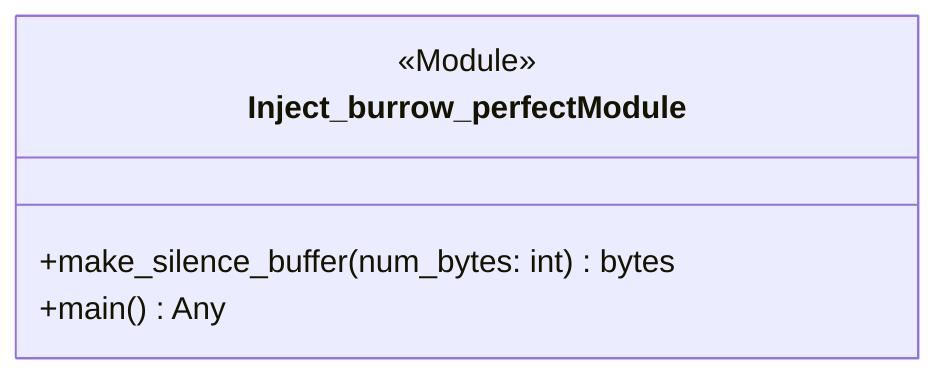

# `inject_burrow_perfect.py` Architecture Documentation

## Architecture Diagram

## Responsibility

Core architecture component for `tools/inject_burrow_perfect.py` providing isolated domain logic and structured APIs.

## Public API

### Function `make_silence_buffer()`
**Signature:** `make_silence_buffer(num_bytes: int) -> bytes`

**Parameters & Expected Values:**
- `num_bytes` (`int`): Value supplied when calling function. Parameter 'num_bytes' passed to function 'make_silence_buffer'

**Local Variables Explanation:**
- `silence_mid` (line 99): Stores intermediate result of `b'\x00\x00\x00\x00\x00\x00\x00\x00\x00\x00\x00\x00\x00\x00\x00\x00'`.
- `silence_end` (line 100): Stores intermediate result of `b'\x00\x01\x00\x00\x00\x00\x00\x00\x00\x00\x00\x00\x00\x00\x00\x00'`.
- `num_blocks` (line 101): Stores intermediate result of `num_bytes // 16`.

### Function `main()`
**Signature:** `main() -> Any`

**Local Variables Explanation:**
- `dne_pos` (line 119): Stores intermediate result of `wad_data.find(b' DNE')`.
- `audio_base` (line 120): Stores intermediate result of `(dne_pos + 2047) // 2048 * 2048`.
- `spsx_pos` (line 122): Stores intermediate result of `wad_data.find(b'XSPS')`.
- `spsx_base` (line 123): Stores intermediate result of `spsx_pos + 8`.
- `wad_data` (line 117): Stores intermediate result of `bytearray(f.read())`.
- `c` (line 131): Stores intermediate result of `item['cue']`.
- `char` (line 132): Stores intermediate result of `item['char']`.
- `wav_p` (line 133): Stores intermediate result of `item['wav']`.
- `sz` (line 134): Stores intermediate result of `item['sz']`.
- `a_off` (line 135): Stores intermediate result of `item['a_off']`.
- `e_off` (line 136): Stores intermediate result of `item['e_off']`.
- `max_samples` (line 145): Stores intermediate result of `sz // 16 * 28`.
- `vag_data` (line 149): Stores intermediate result of `encode_pcm_to_vag(pcm, loop=True)`.
- `pad_bytes` (line 152): Stores intermediate result of `sz - len(vag_data)`.
- `num_pad_blocks` (line 153): Stores intermediate result of `pad_bytes // 16`.
- `silence_mid` (line 154): Stores intermediate result of `b'\x00\x00\x00\x00\x00\x00\x00\x00\x00\x00\x00\x00\x00\x00\x00\x00'`.
- `silence_end` (line 155): Stores intermediate result of `b'\x00\x01\x00\x00\x00\x00\x00\x00\x00\x00\x00\x00\x00\x00\x00\x00'`.
- `abs_audio` (line 166): Stores intermediate result of `audio_base + a_off`.
- `p2` (line 170): Stores intermediate result of `2 << 16 | 2048`.
- `abs_table` (line 171): Stores intermediate result of `spsx_base + e_off`.
- `c` (line 179): Stores intermediate result of `item['cue']`.
- `sz` (line 180): Stores intermediate result of `item['sz']`.
- `a_off` (line 181): Stores intermediate result of `item['a_off']`.
- `e_off` (line 182): Stores intermediate result of `item['e_off']`.
- `mute_buf` (line 184): Stores intermediate result of `make_silence_buffer(sz)`.
- `abs_audio` (line 185): Stores intermediate result of `audio_base + a_off`.
- `p2` (line 189): Stores intermediate result of `2 << 16 | 1486`.
- `abs_table` (line 190): Stores intermediate result of `spsx_base + e_off`.
- `frames` (line 139): Stores intermediate result of `wf.readframes(wf.getnframes())`.
- `pcm` (line 140): Stores intermediate result of `np.frombuffer(frames, dtype=np.int16)`.
- `sr` (line 141): Stores intermediate result of `wf.getframerate()`.
- `pcm` (line 147): Stores intermediate result of `pcm[:max_samples]`.
- `vag_data` (line 158): Stores intermediate result of `vag_data + silence_mid * (num_pad_blocks - 1) + silence_end`.
- `vag_data` (line 160): Stores intermediate result of `bytearray(vag_data[:sz])`.
- `vag_data` (line 162): Stores intermediate result of `bytes(vag_data)`.

**Execution Invocations:** `print, shutil.copy2, wad_data.find, os.path.exists, FileNotFoundError, open, bytearray, encode_pcm_to_vag, struct.pack, make_silence_buffer, f.write, f.read, wave.open, wf.readframes, np.frombuffer, wf.getframerate, len, bytes, wf.getnframes, char.upper`

## Design Reasoning

### Why was 'make_silence_buffer' implemented with this specific layout?

The precise developer motivation for this implementation detail cannot be established with empirical certainty from available AST or git evidence.

**Evidence level:** UNKNOWN
**Evidence detail:** No explicit git commit message or docstring justification found for 'make_silence_buffer'.
**Confidence:** 0.30

**Advantages:**
- standard implementation

**Trade-offs:**
- unknown design trade-offs

### How are module dependencies structured in 'tools/inject_burrow_perfect.py'?

Module isolates internal components [shutil, struct, wave, tools.audio_vag] while using standard external libraries [os, sys, numpy].

**Evidence level:** OBSERVED
**Evidence detail:** AST observed imports: 4 internal, 3 external.
**Confidence:** 0.92

**Advantages:**
- clear module boundary
- explicit import dependencies

**Trade-offs:**
- external package dependency

## Dependencies

### Internal Modules
- `shutil`
- `struct`
- `wave`
- `tools.audio_vag`

### External Dependencies
- `os`
- `sys`
- `numpy`

## Error Handling

Explicitly raised exceptions detected in AST:
- `FileNotFoundError(f'Clean base WAD not found: {SRC_WAD}')`
